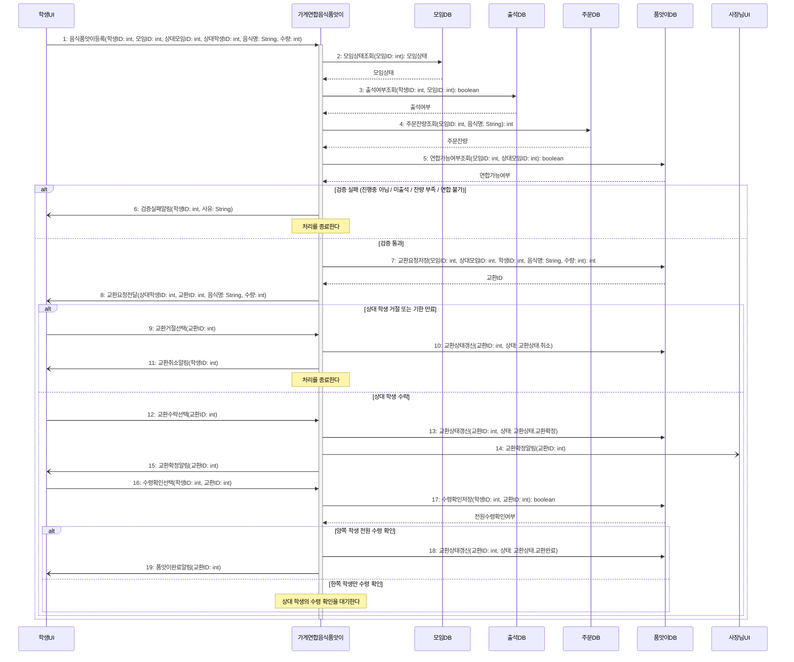

# seq-17 가게연합음식품앗이

## 참여 객체

| 객체 | 종류 | 클래스 파일 |
|---|---|---|
| 가게연합음식품앗이 | 담당 객체 | classes/StoreFoodExchange.md |
| 모임DB | DB | classes/MeetingDB.md |
| 출석DB | DB | classes/AttendanceDB.md |
| 주문DB | DB | classes/OrderDB.md |
| 품앗이DB | DB | classes/FoodExchangeDB.md |
| 학생UI | UI | classes/StudentUI.md |
| 사장님UI | UI | classes/OwnerUI.md |

시작 방식: **사람이 누름** (출석한 학생이 음식 교환을 등록) → `학생UI`

## 다이어그램

## 메시지 ↔ Action 대응표

| 메시지 | Action |
|---|---|
| 1 | 1 |
| 2~5 | 2 |
| 6~8 | 3 |
| 9~15 | 4 |
| 16~19 | 5 |

## 메모

- 2~5번의 검증 조건(모임 진행중, 본인 출석, 주문 잔량 충족, 모임 간 연합 가능 조건) 중 하나라도 실패하면 6번으로 즉시 종료된다.
- 13번으로 교환확정 상태가 되면 양쪽 가게 사장님UI(14번) 및 학생UI(15번)에 알림이 전송된다.
- 17번 수령확인은 양쪽 학생이 모두 눌러 전원 확인이 true가 될 때만 18번 교환완료로 갱신된다.
- 6, 8, 11, 14, 15, 19번 알림은 비동기로 전송된다.
