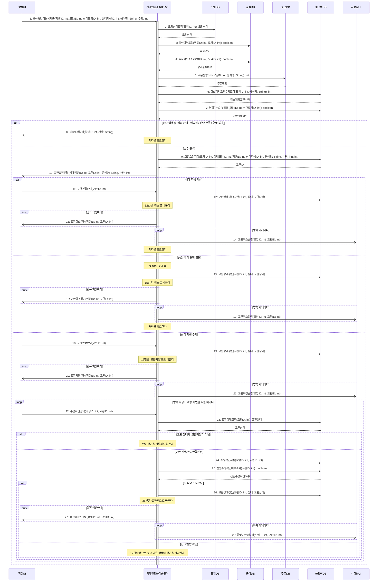

# seq-17 가게연합음식품앗이

## 참여 객체

| 객체 | 종류 | 클래스 파일 |
|---|---|---|
| 가게연합음식품앗이 | 담당 객체 | classes/StoreFoodExchange.md |
| 모임DB | DB | classes/MeetingDB.md |
| 출석DB | DB | classes/AttendanceDB.md |
| 주문DB | DB | classes/OrderDB.md |
| 품앗이DB | DB | classes/FoodExchangeDB.md |
| 학생UI | UI | classes/StudentUI.md |
| 사장님UI | UI | classes/OwnerUI.md |

시작 방식: **사람이 누름** (출석한 학생이 음식 교환을 등록) → `학생UI`

## 다이어그램

## 메시지 ↔ Action 대응표

| 메시지 | Action |
|---|---|
| 1 | 1 |
| 2~7 | 2 |
| 8~10 | 3 |
| 11~21 | 4 |
| 22~28 | 5 |

## 메모

- 3번은 등록한 학생, 4번은 상대 학생과 상대 모임의 출석을 확인한다.
- 6번은 교환 상태가 '취소'가 아닌 교환의 수량을 돌려준다. 주문DB의 잔량은 교환으로 줄지 않으므로 '교환완료' 수량도 포함한다.
- 2~7번의 검증 조건 중 하나라도 실패하면 8번으로 즉시 종료된다.
- 9번은 뒤의 메시지에서 쓸 교환ID를 돌려받는다.
- 14, 17, 21, 28번의 모임ID는 양쪽 가게의 사장님UI를 구분하는 값이다.
- 24번은 양쪽 학생이 각각 저장하고, 25번이 true일 때만 26번으로 교환완료로 갱신된다.
- 8, 10, 13, 14, 16, 17, 20, 21, 27, 28번 알림은 비동기로 전송된다.
