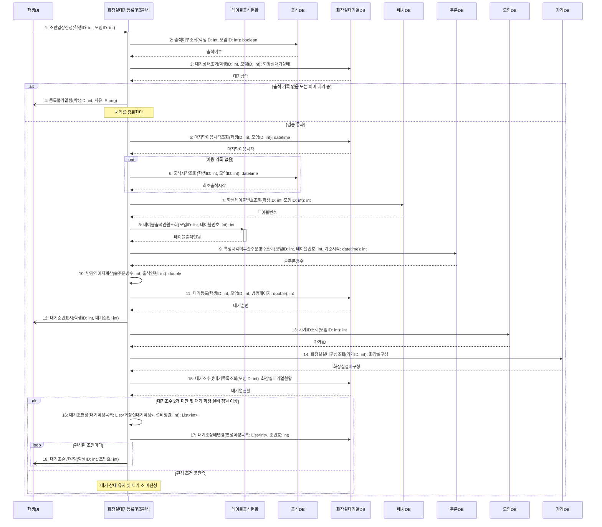

# seq-18-1 화장실대기등록및조편성

## 참여 객체

| 객체 | 종류 | 클래스 파일 |
|---|---|---|
| 화장실대기등록및조편성 | 담당 객체 | classes/ToiletWaitAndGroup.md |
| 테이블출석현황 | 공통 객체 | classes/TableAttendanceStatus.md |
| 출석DB | DB | classes/AttendanceDB.md |
| 화장실대기열DB | DB | classes/ToiletQueueDB.md |
| 배치DB | DB | classes/ArrangementDB.md |
| 주문DB | DB | classes/OrderDB.md |
| 모임DB | DB | classes/MeetingDB.md |
| 가게DB | DB | classes/StoreDB.md |
| 학생UI | UI | classes/StudentUI.md |

시작 방식: **사람이 누름** (남학생이 '소변 입장' 선택) → `학생UI`

## 다이어그램

## 메시지 ↔ Action 대응표

| 메시지 | Action |
|---|---|
| 1~4 | 1, 2 |
| 5~10 | 3 |
| 11~12 | 4 |
| 13~15 | 5 |
| 16~18 | 6, 7 |

## 메모

- 1번 신청은 남학생의 학생UI에 한해 동반 입장에 동의할 때만 선택 가능하다.
- 8번 테이블출석인원조회는 공통 객체 테이블출석현황의 표준 연산(GLOSSARY 5장)을 재사용한다.
- 10번 방광게이지 = 기준 시각 이후 술 주문 병 수 ÷ 테이블 출석 인원으로 산출된다.
- 14번 설비 구성에서 최대 정원 K = 소변기 수 + 대변기 수다.
- 16번 대기조편성은 선착순 첫 학생 1명과 나머지 중 방광 게이지가 높은 상위 K-1명으로 편성한다.
- 13번은 모임이 열리는 가게의 ID를 조회해 14번에 쓴다.
- 4, 12, 18번 알림은 비동기로 전송된다.
