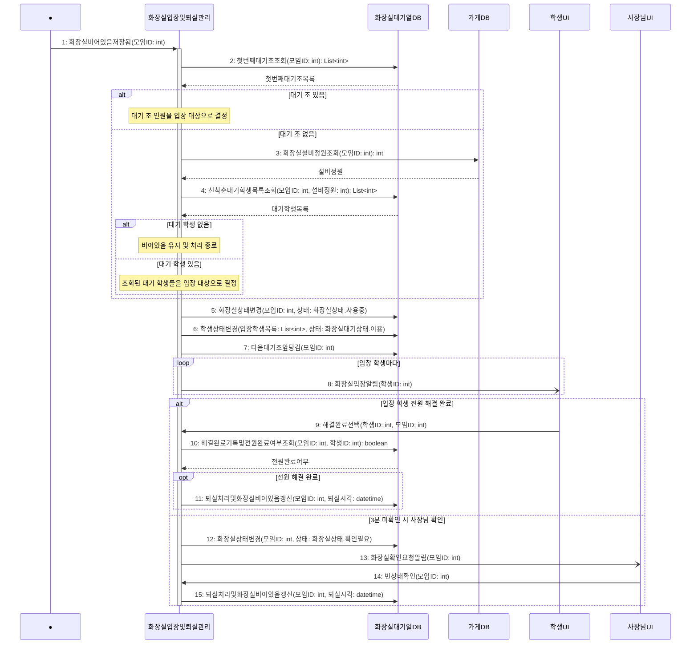

# seq-18-2 입장및퇴실관리

## 참여 객체

| 객체 | 종류 | 클래스 파일 |
|---|---|---|
| 화장실입장및퇴실관리 | 담당 객체 | classes/ToiletEntryExitManagement.md |
| 화장실대기열DB | DB | classes/ToiletQueueDB.md |
| 가게DB | DB | classes/StoreDB.md |
| 학생UI | UI | classes/StudentUI.md |
| 사장님UI | UI | classes/OwnerUI.md |

시작 방식: **데이터 변화** (화장실 상태가 '비어있음'으로 저장됨) → Found Message

## 다이어그램

## 메시지 ↔ Action 대응표

| 메시지 | Action |
|---|---|
| 1~4 | 1, 2 |
| 5~8 | 3 |
| 9~11 | 4 |
| 12~15 | 5 |

## 메모

- 1번 시작 메시지는 화장실 사용 상태가 '비어있음'으로 바뀔 때 발생하는 Found Message다.
- 5~7번은 화장실을 '사용중'으로 바꾸고, 조원을 '이용' 상태로 갱신하며 다음 대기 조를 앞으로 앞당긴다.
- 8번 화장실입장알림과 13번 사장님 확인 요청은 비동기로 전송된다.
- 11번 및 15번 퇴실 처리 시 학생 상태를 '퇴실'로 바꾸고 마지막 이용 시각을 갱신하며 화장실을 '비어있음'으로 되돌린다.
