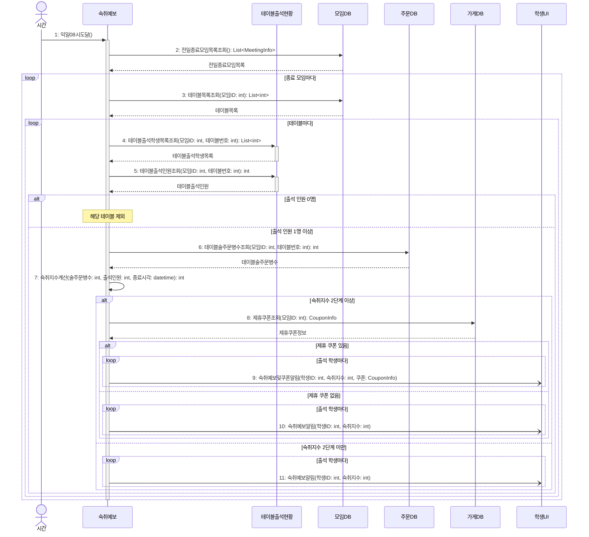

# seq-19 모임다음날숙취예보

## 참여 객체

| 객체 | 종류 | 클래스 파일 |
|---|---|---|
| 숙취예보 | 담당 객체 | classes/HangoverForecast.md |
| 테이블출석현황 | 공통 객체 | classes/TableAttendanceStatus.md |
| 모임DB | DB | classes/MeetingDB.md |
| 주문DB | DB | classes/OrderDB.md |
| 가게DB | DB | classes/StoreDB.md |
| 학생UI | UI | classes/StudentUI.md |

시작 방식: **정해진 시각** (다음 날 08:00 도달) → `시간` 액터

## 다이어그램

## 메시지 ↔ Action 대응표

| 메시지 | Action |
|---|---|
| 1~2 | 1 |
| 3~5 | 2 |
| 6~7 | 3 |
| 8~10 | 4 |
| 11 | 5 |

## 메모

- 1번 시작 메시지는 매일 08:00에 실행되는 정기 배치 스케줄러 시간 사건이다.
- 4번과 5번은 공통 객체 테이블출석현황의 표준 연산(GLOSSARY 5장)을 재사용한다.
- 7번 숙취 지수는 (술 주문 병 수 ÷ 출석 인원 ÷ 2)의 내림값에 23시 이후 종료 시 1을 더해 최대 3단계로 산출된다.
- 9, 10, 11번 알림은 비동기 푸시 알림으로 전송된다.
