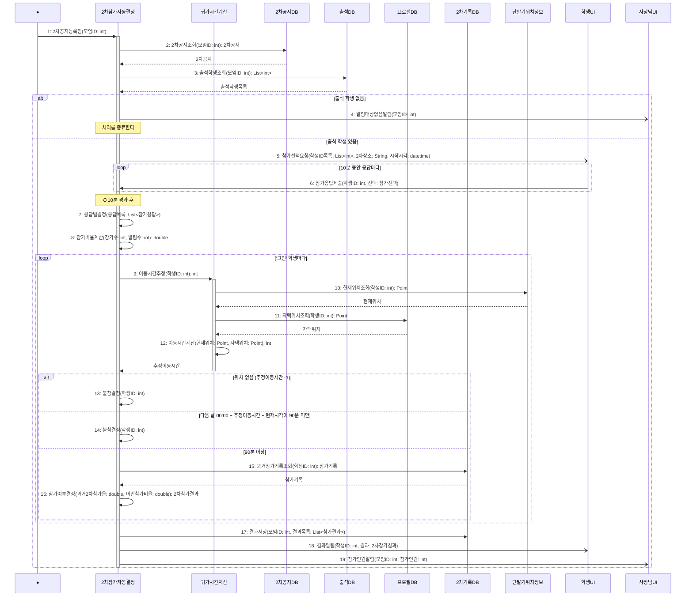

# seq-20 2차참가자동결정

## 참여 객체

| 객체 | 종류 | 클래스 파일 |
|---|---|---|
| 2차참가자동결정 | 담당 객체 | classes/SecondRoundAutoDecision.md |
| 귀가시간계산 | 공통 객체 | classes/ReturnHomeTimeCalc.md |
| 2차공지DB | DB | classes/SecondNoticeDB.md |
| 출석DB | DB | classes/AttendanceDB.md |
| 프로필DB | DB | classes/ProfileDB.md |
| 2차기록DB | DB | classes/SecondRecordDB.md |
| 단말기위치정보 | 외부 | classes/DeviceLocation.md |
| 학생UI | UI | classes/StudentUI.md |
| 사장님UI | UI | classes/OwnerUI.md |

시작 방식: **데이터 변화** (2차공지DB에 2차 공지가 등록됨) → Found Message

## 다이어그램

## 메시지 ↔ Action 대응표

| 메시지 | Action |
|---|---|
| 1~4 | 1 |
| 5~6 | 2 |
| 7~8 | 3 |
| 9~14 | 4 |
| 15~16 | 5 |
| 17~19 | 6 |

## 메모

- 4번 알림대상없음알림은 출석한 학생이 없을 때 사장님UI에 알리고 처리를 종료하는 Action 1의 예외 종료 동작이다.
- 귀가시간계산은 15. 당일 안심귀가와 같이 쓰는 공통 객체다.
- 이동시간계산은 하버사인 공식으로 직선거리 d를 계산하고, 도로 굴곡 계수 1.3을 곱해 D를 구한 뒤 1.5km 이하는 도보(4km/h), 초과는 차량(25km/h)으로 계산한다.
- 추정이동시간은 위치를 얻지 못하면 -1을 돌려준다. 위치 권한 동의는 Pre-condition에서 전제한다.
